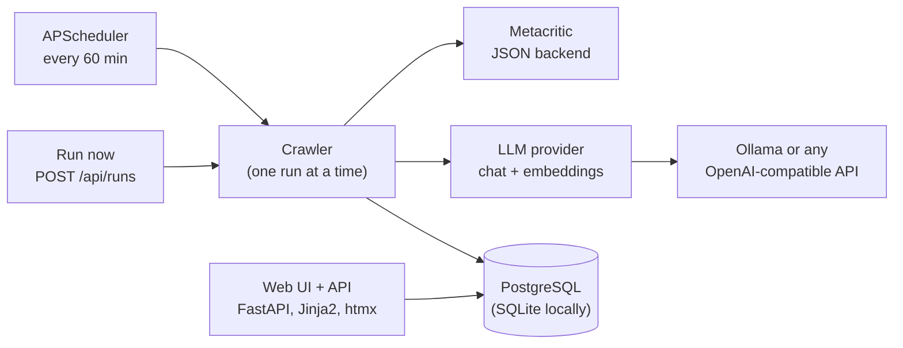

# Metacritic games crawler

Every hour this service picks 20 games from Metacritic that it hasn't processed yet that day,
then adds them to its database or updates them. For each game it stores the cover, platforms
with Metascore and user score, developer, description and video link. It also stores an LLM
summary of what critics and players like and dislike, and links similar games from the catalog.
A web UI lists the games, shows each game's card, and monitors the crawler live.

Data comes from Metacritic's JSON backend, not HTML scraping. See
[docs/metacritic-api.md](docs/metacritic-api.md).

## Architecture



One FastAPI process holds both the web UI and the scheduler. A crawl run lists games, fetches
each game's details and per-platform scores, summarizes its reviews, embeds it for similarity,
and records progress and errors on its `crawl_runs` row. The monitor page reads that row.

## Demo walkthrough

Needs Docker. With the bundled Ollama, give Docker about 8 GB of memory.

**1. Start everything.**

```bash
cp .env.example .env
docker compose --profile ollama up --build
```

The first start downloads the Ollama image (about 3.8 GB) and the `gemma3:4b` and
`nomic-embed-text` models (about 3.6 GB). The app waits until both models are ready, then
applies database migrations and starts the first crawl.

Ollama in Docker on a Mac runs on the CPU only. For faster summaries, use the Mac's own Ollama
instead: run `ollama pull gemma3:4b && ollama pull nomic-embed-text`, set
`LLM_BASE_URL=http://host.docker.internal:11434/v1` in `.env`, and start with
`docker compose up --build` (no profile). A hosted API works the same way, using
`LLM_BASE_URL`, `LLM_API_KEY`, `LLM_MODEL` and `EMBED_MODEL`.

**2. Watch the first crawl.** Open <http://localhost:8000/monitor>. Run #1 started when the app
booted. Every 3 seconds the panel shows its status, games processed (up to 20), the error count
with the last errors, and when the next scheduled run is due. A 20-game run took about
6 minutes with Ollama running natively on a Mac. It is slower with CPU-only Ollama in Docker,
and faster with a hosted API.

**3. Browse the catalog.** Open <http://localhost:8000>. Today's 20 New Releases are listed.
- Type in the search box: the list filters as you type.
- Pick a platform: the badges switch to that platform's scores.
- Sort by user score.
- The URL keeps the filters, so you can share it.

**4. Open a game card.** Click any game to see:
- cover, developer and genres
- Metascore and user score per platform
- the video link and a link to the game on Metacritic
- the description
- what critics and players like and dislike
- up to six similar games; click one to jump to its card

**5. Run now.** On the monitor, press **Run now**.
- Run #2 starts at once, and the button stays disabled while it runs.
- The New Releases were already processed today, so this run takes the next 20 games from
  "See all, newest first".
- Asking for another run meanwhile is refused:

```bash
curl -s -X POST localhost:8000/api/runs     # 409 {"detail": "A crawl is already running", "run_id": 2}
curl -s localhost:8000/api/runs/latest      # status, processed, errors, error_log
```

**6. Check the day cycle.**

```bash
docker compose exec db psql -U metacritic -c \
  "select date, phase, next_page, json_array_length(processed_slugs) as processed from crawl_state"
```

Today's row is in the `browse` phase and lists every slug processed so far. Slugs listed there
are skipped until the next UTC day, when the cycle starts over with New Releases.

**7. See a failure handled.** Run `docker compose stop ollama`, then press **Run now**. The games
are still saved, and the monitor lists the summary and embedding errors under the run. Run
`docker compose start ollama` afterwards.

**8. Stop.** `docker compose down` keeps the data; `docker compose down -v` wipes it.

## Configuration

Every setting is an environment variable. The main ones are below; the full list with defaults
is in [.env.example](.env.example).

| Variable | Default | Meaning |
|---|---|---|
| `CRAWL_INTERVAL_MINUTES` | `60` | Time between scheduled runs; the first run starts with the app |
| `GAMES_PER_RUN` | `20` | New games per run |
| `MAX_PAGES_PER_RUN` | `10` | Pages a run may read looking for new games before giving up |
| `REQUEST_DELAY_SECONDS` | `1.0` | Pause between Metacritic requests |
| `MAX_RETRIES`, `RETRY_BACKOFF_SECONDS`, `MAX_BACKOFF_SECONDS` | `3`, `2`, `60` | Retries on 429/5xx; `Retry-After` is honored up to the max |
| `LLM_BASE_URL` | local Ollama | Any OpenAI-compatible API (`/chat/completions`, `/embeddings`) |
| `LLM_MODEL`, `EMBED_MODEL` | `gemma3:4b`, `nomic-embed-text` | Models for summaries and similar games |
| `SCHEDULER_ENABLED` | `true` | Turn off the hourly runs; Run now still works |

## How it works

**Crawl schedule.**
- **The crawl day is the UTC date.** The first run after 00:00 UTC takes the 20 games in
  New Releases. Later runs that day page through "See all, newest first", skipping games
  already processed that day. Re-crawling a game updates its row instead of adding a new one.
- Metacritic's newest-first order isn't stable for games released on the same date, so pages
  overlap. A run keeps reading pages until it has 20 new games, up to `MAX_PAGES_PER_RUN`.
- Only one run happens at a time, across processes too. A run claims a row in `crawl_runs`
  with status `running`, and a partial unique index allows only one such row. A scheduled run
  that finds one already running is skipped, and **Run now** answers 409.
- A failure for one game, platform, summary or embedding goes into the run's `error_log`
  (the last 20 errors with source, URL and message), and the run carries on. Runs still marked
  "running" when the app starts are marked failed.

**Review summaries.** For each game the crawler reads the latest critic reviews (10) and user
reviews (50). It asks the LLM for up to five likes and five dislikes per source, and stores them
with a hash of the reviews. The LLM is called again only when the reviews change. A failed LLM
call is retried once.

**Similar games.** Each game gets an embedding of its title, genres, description and the "likes"
from its review summaries, from the provider's `/embeddings` endpoint. The vector is stored with
the model name and a hash of that text, so it is recomputed only when the text or the model
changes. The card ranks other games by cosine similarity. A shared developer adds 0.05 and
shared platforms add up to 0.03, which breaks near-ties without overriding the content match. If
the embed model is unavailable, the run logs it once and skips embeddings, and cards without a
vector hide the similar games block.

**Web UI and API.**

| Path | What it is |
|---|---|
| `/` | Game list with title search, platform filter and sorting by Metascore, user score, recently added or title. With a platform selected, the scores shown are that platform's; otherwise each game shows its best score |
| `/games/{slug}` | Game card |
| `/monitor` | Crawler monitor, polling `/api/runs/latest` every 3 seconds via htmx |
| `GET /api/runs/latest` | Latest run as JSON: `id`, `status`, `processed`, `errors`, `error_log`, times. 404 before the first run |
| `POST /api/runs` | Starts a crawl in the background and returns `202 {"run_id": N}` at once, or `409` with the running run's id |
| `GET /health` | `{"status": "ok"}` once the database answers |

The `/api/runs` routes return an HTML fragment when htmx calls them. Unknown pages get an HTML
404, and unknown `/api/` paths a JSON one.

**Database.** Alembic migrations in [migrations/](migrations/) run when the app starts. After
changing a model, generate a migration with
`uv run alembic revision --autogenerate -m "describe the change"`. A database created before
migrations existed and matching the models can be marked current with `uv run alembic stamp head`.

## Local development

Local development uses SQLite, [uv](https://docs.astral.sh/uv/) and a local Ollama:

```bash
make run     # web app with the hourly scheduler on http://localhost:8000
make crawl   # one crawl run, then exit
make test    # tests run offline against saved Metacritic responses and a fake LLM
make lint
```

## Decisions and limits

- **JSON backend instead of HTML.** Metacritic's pages are rendered from
  `backend.metacritic.com`, which answers plain requests without keys or cookies. The crawler
  sends a descriptive User-Agent and makes about one request per second.
- **The scores shown are Metacritic's.** A Metascore needs 4 critic reviews and a user score
  needs enough ratings; until then the API sends nothing usable, and the UI shows "tbd" like
  the site does.
- **Similarity is computed when a card is viewed**, by brute force over all stored vectors. That
  is fine up to a few thousand games; past that, precompute neighbours at crawl time or use
  pgvector.
- **One app process.** The scheduler lives in the web process, so run a single worker. The run
  lock still protects against a second process.
- **Not built:** the optional YouTube let's-play summaries.
